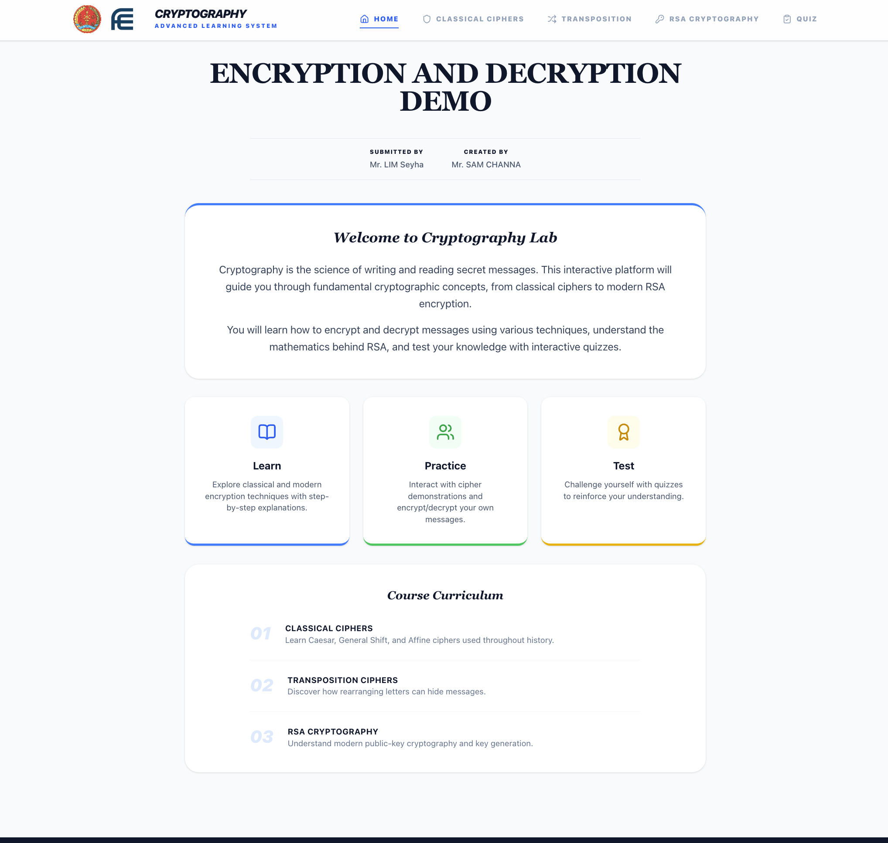
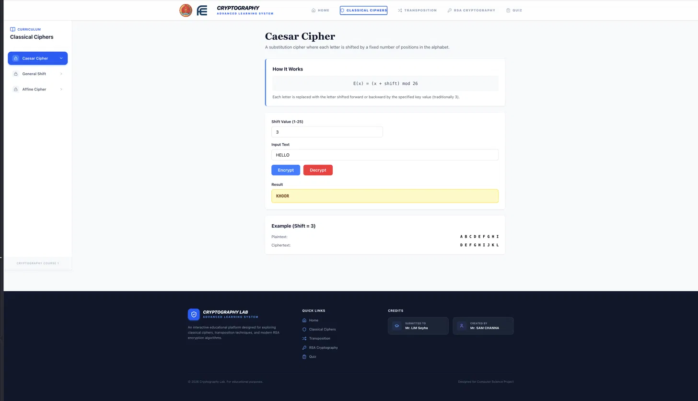

# 🔐 Cryptography Lab — Interactive Learning System

An interactive web platform for learning cryptography: classical ciphers, transposition, and RSA, with step-by-step explanations, live encrypt/decrypt demos, and a quiz.

🔗 **Live Demo:** [crytography-dusky.vercel.app](https://crytography-dusky.vercel.app)

🎯 **Purpose:** Created for a **Discrete Mathematics** course project, showing how modular arithmetic, gcd and prime numbers are used in real encryption.

---

## ✨ Features

- 🏛️ **Classical Ciphers**
  - **Caesar Cipher** — fixed shift encryption and decryption
  - **General Shift** — any shift from 0 to 25, with a **Brute Force** mode
  - **Affine Cipher** — `E(x) = (ax + b) mod 26` with valid `a` values (coprime with 26)
- 🔀 **Transposition Cipher** — keyword-based matrix encryption with a visual matrix and an explanation video
- 🔑 **RSA Cryptography**
  - **Key Generation** — from primes `p`, `q` and public exponent `e`
  - **Encryption** — `C = M^e mod n`
  - **Decryption** — `M = C^d mod n`
  - Built-in examples (e.g. p=61, q=53, e=17, n=3233) and quick prime selection
- 📝 **Quiz** — 10 questions with a progress bar and live score
- 🧭 Sidebar curriculum navigation for each lesson

## 📸 Screenshots

| Home | Caesar Cipher |
|------|---------------|
|  |  |

## 🧮 Discrete Math Concepts

| Concept | Where it is used |
|---------|------------------|
| Modular arithmetic (`mod 26`, `mod n`) | Caesar, General Shift, Affine, RSA |
| Greatest common divisor (gcd) | Affine cipher (`gcd(a, 26) = 1`), RSA (`gcd(e, φ(n)) = 1`) |
| Prime numbers | RSA key generation (`p`, `q`) |
| Euler's totient `φ(n)` | RSA (`φ(n) = (p−1)(q−1)`) |
| Modular inverse (extended Euclidean algorithm) | Affine decryption, RSA private key `d` |
| Modular exponentiation | RSA encryption and decryption |
| Permutations | Transposition cipher |

## 📐 Algorithms Implemented

| Algorithm | Formula |
|-----------|---------|
| Caesar / General Shift | `E(x) = (x + k) mod 26` |
| Affine | `E(x) = (ax + b) mod 26`, gcd(a, 26) = 1 |
| Transposition | Columns read in the alphabetical order of the keyword |
| RSA key generation | `n = p·q`, `φ(n) = (p−1)(q−1)`, `d = e⁻¹ mod φ(n)` |
| RSA encrypt / decrypt | `C = M^e mod n`, `M = C^d mod n` |

> ⚠️ This project is for **educational purposes only**. Do not use these implementations to protect real data.

## 🛠️ Tech Stack

- **React** + **Vite**
- **JavaScript (ES6)** with native `BigInt` for RSA calculations
- **CSS**
- Deployed on **Vercel**

## 📁 Project Structure

```
src/
├── assets/            # images
├── components/
│   ├── ciphers/       # CaesarCipher, GeneralShift, AffineCipher, RSAKeyGen, RSAEncrypt, RSADecrypt
│   ├── lessons/       # ClassicalCiphers, TranspositionCipher, RSACryptography, Quiz, Dashboard
│   ├── Navbar.jsx
│   ├── Sidebar.jsx
│   ├── Footer.jsx
│   └── StickyNote.jsx
├── utils/
│   └── cryptoUtils.js # cipher + RSA algorithms (modPow, modInverse, isPrime, ...)
├── App.jsx
└── main.jsx
```

## 🚀 Getting Started

```bash
git clone https://github.com/Chana758/CRYTOGRAPHY.git
cd CRYTOGRAPHY
npm install
npm run dev
```

## 👥 Credits

- **Created by:** Sam Channa
- **Submitted to:** Mr. Lim Seyha
- **Course:** Discrete Mathematics

## 👤 Author

**Chana** — [@Chana758](https://github.com/Chana758)
